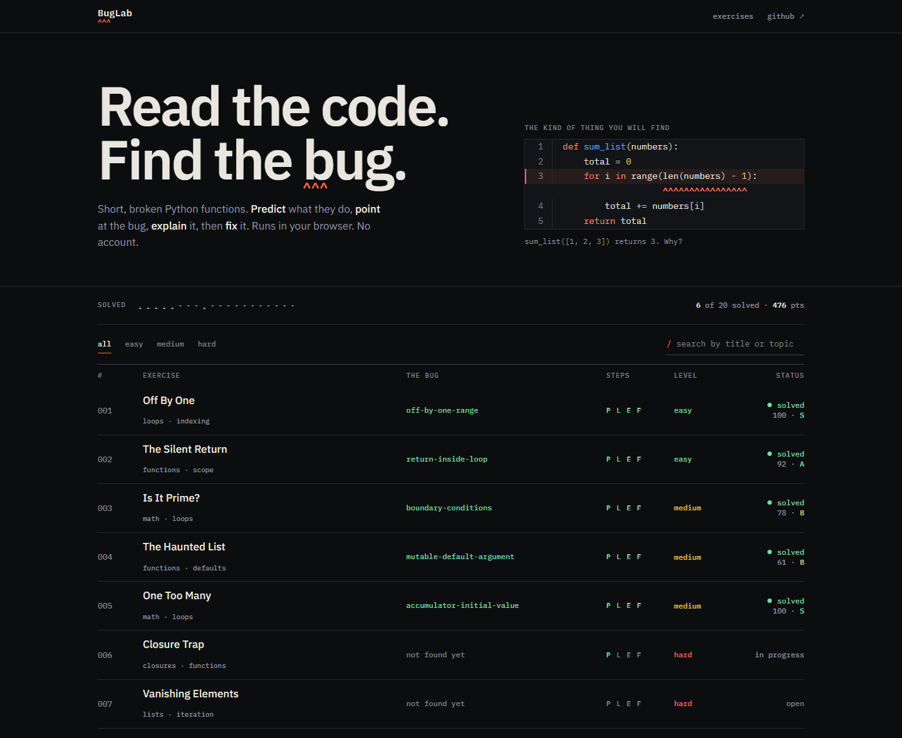
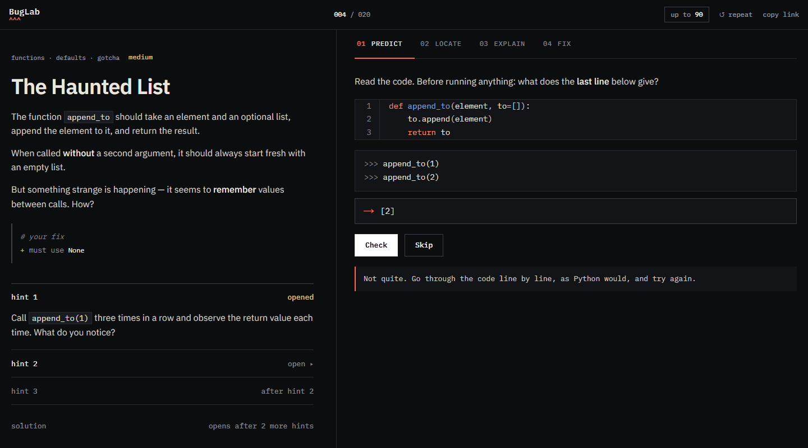
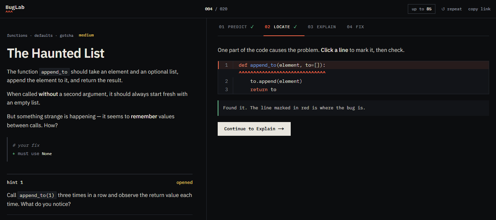
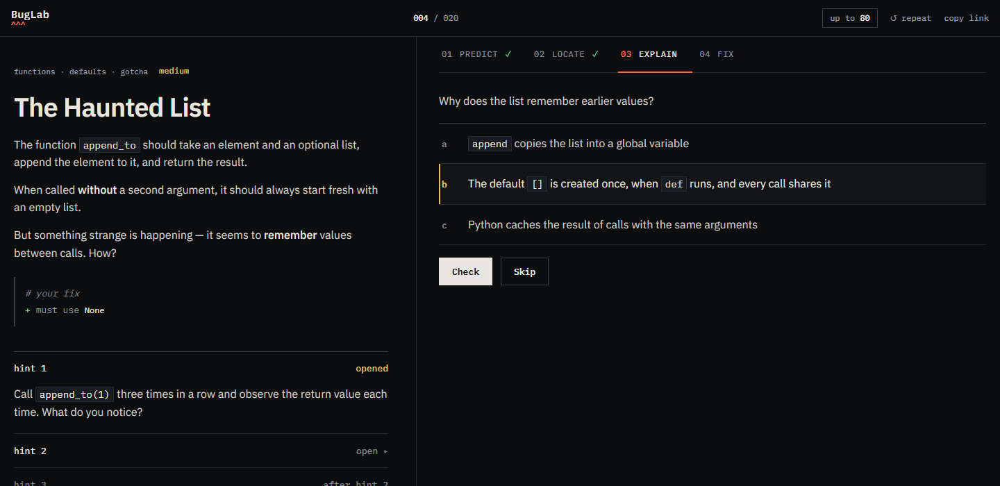
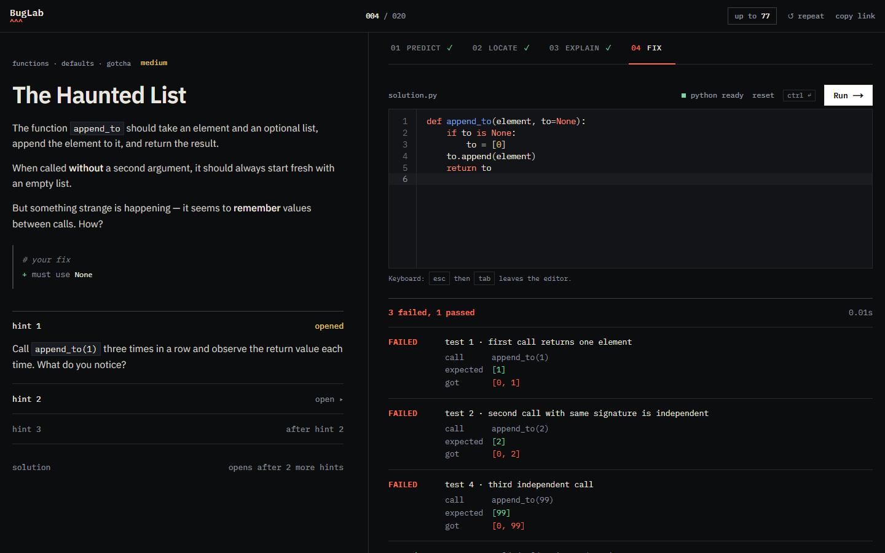
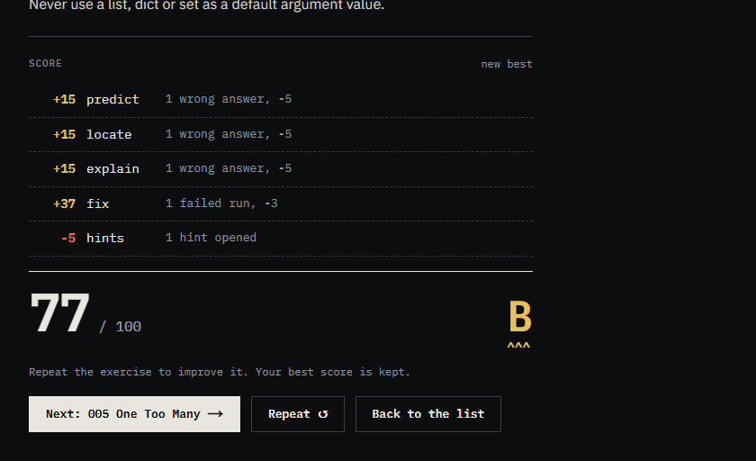
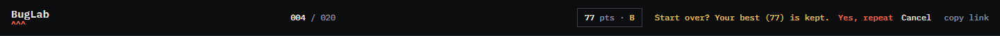
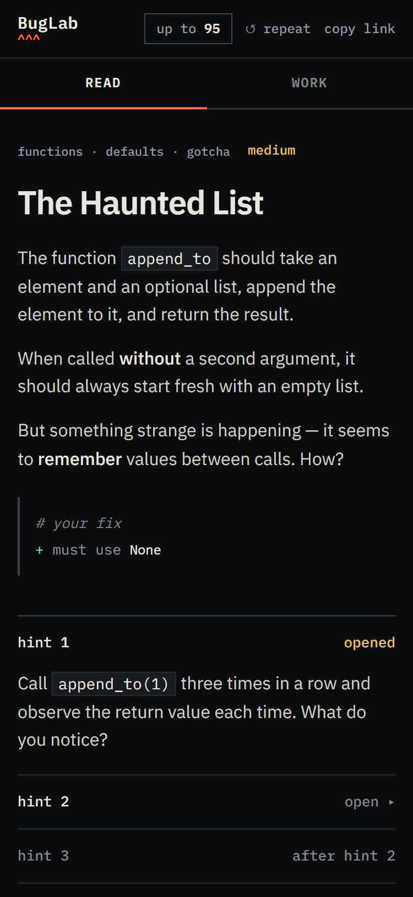
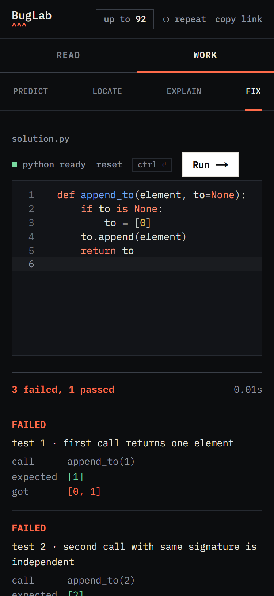

# BugLab

**Read the code. Find the bug.**

BugLab teaches beginners to *read* Python and spot errors. Each exercise is one short, broken function, and you work through it in up to four steps. There is no backend, no account and no tracking: Python runs in your browser and your progress stays in it.



The list hides the name of each bug until you solve it, so choosing an exercise never spoils it. The dots are your progress, the points are the best score of each exercise, and the letters `P L E F` show which steps of each exercise you have done.

## How an exercise works

You can do the steps in order, skip any of them, or jump straight to the one you want. Hints open one at a time on the left, and the reference solution unlocks after the last hint.

### 1. Predict: what does this code do?

Read the function and type what the last call gives, *before* running anything. An error counts as an answer too: type its name, like `TypeError`. Spacing and quote style do not matter.



### 2. Locate: where is the bug?

Click the line you think is wrong, then check. When you find it, BugLab points at it the way Python points at an error in a traceback, with `^^^^`.



### 3. Explain: why does it happen?

Pick the real reason from a few options that a beginner could believe.



### 4. Fix: make the tests pass

Edit the code and run it (press `Ctrl+Enter`, or `Cmd+Enter` on a Mac). Failed tests show what was called, what you expected and what you got, like a pytest report. An error shows a real Python traceback. Some exercises add a rule for your fix, for example "must use `None`"; they are checked before anything runs.



Your code runs in a Web Worker with a 5 second limit, so an infinite loop stops with a message instead of freezing the page.

## Score

Every exercise is worth up to **100 points**: Predict 20, Locate 20, Explain 20 and Fix 40.

| What happens | Effect |
|---|---|
| A wrong answer in Predict, Locate or Explain | -5 from that step |
| A run of the tests that does not pass | -3 from Fix |
| Each hint opened | -5 from the total |
| Opening the solution *before* solving | Fix is worth 0 |
| A step you skipped | worth 0 |
| A step you completed | worth at least 5 |

The top bar always shows the most you can still earn (`up to 90`): it starts at 100 and only goes down, so you see each mistake the moment it costs points. When you solve the exercise you get a receipt that lists every line, the total and a grade: **S** from 95, **A** from 80, **B** from 60 and **C** below. Hints or the solution opened *after* solving cost nothing.



## Repeat

For extra practice, or to beat your score, press **repeat** in the top bar (or **Repeat** on the solved panel). It starts that exercise over from scratch: your code, steps, hints and mistakes are cleared. It asks first when there is something to lose, and **your best score is kept**, so repeating never costs you points. The home page keeps counting the exercise as solved.



## On a phone

The exercise page has two tabs: **Read** (instructions and hints) and **Work** (the steps, the editor and the results).

<p>
  
  &nbsp;&nbsp;
  
</p>

## Run it locally

```bash
git clone https://github.com/HenryD11703/BugLab
cd BugLab
npm install
npm run dev        # http://localhost:3000
```

Needs Node 20.9 or newer (CI uses 22). Nothing else: no environment variables.

## Commands

| Command | What it does |
|---|---|
| `npm run dev` / `npm run build` / `npm start` | develop, build, serve the build |
| `npm run lint` and `npm run typecheck` | ESLint and `tsc --noEmit` |
| `npm test` | unit tests **and the exercise gates** (needs Python on your `PATH`, ideally 3.12) |
| `npm run test:e2e` | builds, then runs Playwright on desktop and phone, with axe |
| `npm run check` | lint + typecheck + `npm test` |
| `npm run screenshots` | regenerates the pictures in this README from the real app (see `scripts/readme-screenshots.mjs`) |

CI runs the checks and the tests on every push to `main` and every pull request, with Python 3.12 (the version Pyodide 0.27 ships).

## How it is built

- **Next.js 16** (App Router) with every page generated at build time, **React 19**, **TypeScript**, **Tailwind 4** for the reset only; the design lives in `app/globals.css`.
- **CodeMirror 6** for the editor and **`@lezer/python`** for parsing: it checks an exercise's rules ("no `sum()`", "use a loop") and highlights read-only code, without running anything.
- **Pyodide** in a Web Worker runs the learner's code. Every run starts in a fresh namespace, and a run that does not finish in 5 seconds is stopped by terminating the worker.
- **zod** validates every `exercise.json` at build time, so a broken exercise fails the build.

Read [`docs/ARCHITECTURE.md`](docs/ARCHITECTURE.md) for the decisions and the alternatives we rejected, and [`docs/00-principles.md`](docs/00-principles.md) for the rules that every change must respect.

## Exercises

There are 20 exercises, from easy to hard, each with all four steps. An exercise is a folder:

```
exercises/004-mutable-default/
  exercise.json     title, text, hints, explanation and the data for each step
  buggy.py          what the learner starts with
  solution.py       the reference solution
  wrong-fixes/      plausible wrong fixes that must still fail the tests
```

CI checks every exercise against real Python: the buggy code must fail, the solution must pass, every wrong fix must fail, and the answer to each Predict step must be what Python really prints.

**Want to add one?** Read [`CONTRIBUTING.md`](CONTRIBUTING.md) and the format reference in [`exercises/README.md`](exercises/README.md).

## Known limits

- Running code needs to download Pyodide (about 10 MB) from a CDN the first time. Without it the Predict, Locate and Explain steps still work, and Fix says so.
- The names of the exercise folders are part of their URLs and describe the bug. The home page hides the bug names, the URLs do not.
- The reference solutions are public in this repository; "show solution" only unlocks them in the interface.

## License

MIT. See [`LICENSE`](LICENSE).
